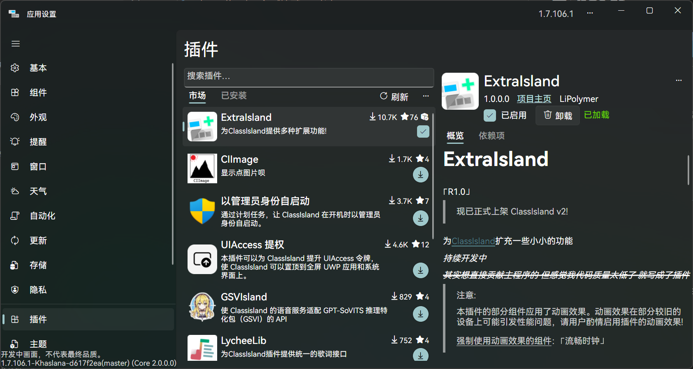
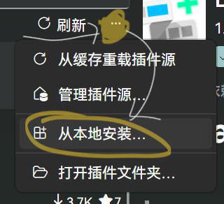

# 快速开始

欢迎使用 **ExtraIsland**！本插件适用于 **ClassIsland v2**（插件 API 版本 `2.0.0.0`，对应仓库 `v1` 分支）。

开始使用前，请先安装本插件。

## 自动安装（推荐）

ExtraIsland 已正式上架 ClassIsland 插件市场！

1. 打开 ClassIsland 设置，进入 **插件** → **插件市场**。
2. 搜索 **ExtraIsland**，点击安装并按提示重启 ClassIsland 即可。




## 手动安装

由于离线环境、网络限制或需要尝鲜测试版本时，可以通过 `.cipx` 插件包进行手动安装。

### 获取安装包

安装包为 `*.cipx` 格式文件。

#### 稳定 / 预览发布版本

1. 前往 [GitHub Releases](https://github.com/LiPolymer/ExtraIsland/releases/) 或 [GitLab Releases](https://gitlab.com/LiPolymer/ExtraIsland/-/releases)。
2. 选择需要安装的 Release 版本。
3. 下载附件 `ink.lipoly.ext.extraisland.cipx`。

> [!TIP]
> 如果担心下载到的插件文件被修改，可在发布说明中核对 `MD5` 校验值。Windows 下可在终端执行：
> ```powershell
> Get-FileHash .\ink.lipoly.ext.extraisland.cipx -Algorithm MD5
> ```

#### 尝鲜版本（CI 构建）

> [!CAUTION]
> （；´д｀）ゞ 稍等一下！
>
> 下载前请务必核对构建 Pipeline 所属分支：
> - `v1` 分支适用于 **ClassIsland v2**
> - `master` 分支适用于 **ClassIsland v1**（旧版）
>
> 尝鲜版本包含最新提交，但可能存在尚未解决的 Bug。**不建议直接部署到正在上课使用的班级电脑**，以免影响正常教学秩序。

1. 前往 [GitLab Pipelines](https://gitlab.com/LiPolymer/ExtraIsland/-/pipelines)。
2. 选取目标分支的最新成功 Pipeline。
3. 点击右侧下载按钮，选择 `build_job:archive`。
4. 解压下载得到的 `artifacts.zip`，依次进入 `ExtraIsland > bin > Release > net10.0-windows`。
5. 选中该目录内的所有文件，打包为 `.zip` 压缩包，并将文件扩展名修改为 `.cipx`。

### 从本地安装

1. 打开 ClassIsland 设置面板，切换到 **插件** 页面。
2. 点击页面中部的三点菜单 。
3. 选择 **从本地安装...**。
4. 选中刚才获取的 `*.cipx` 文件确认导入，并按提示重启 ClassIsland。

## 后续配置建议

- 安装完成后，可在 ClassIsland 设置侧边栏找到 **ExtraIsland** 分组，包含 [主设置与全局选项](/instruction/settings) 以及 [值日表全局配置](/components/on-duty)。
- 若希望把组件添加到主界面或课表组件方案中，可前往 **组件** 页面选择所需组件，详见 [组件总览](/components/)。
- 如需搭配 `LycheeLib`、`SuperAutoIsland` 或 `IslandCaller` 使用，请查看 [联动生态](/instruction/integrations)。
